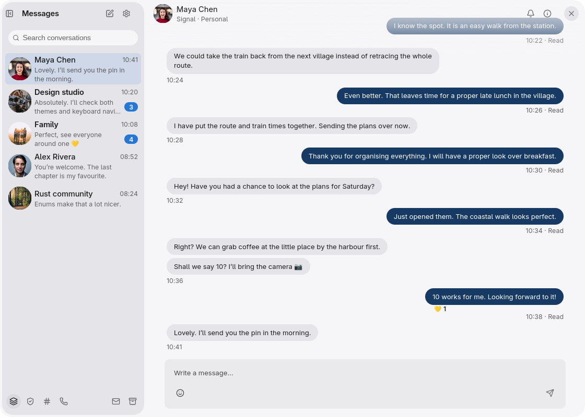
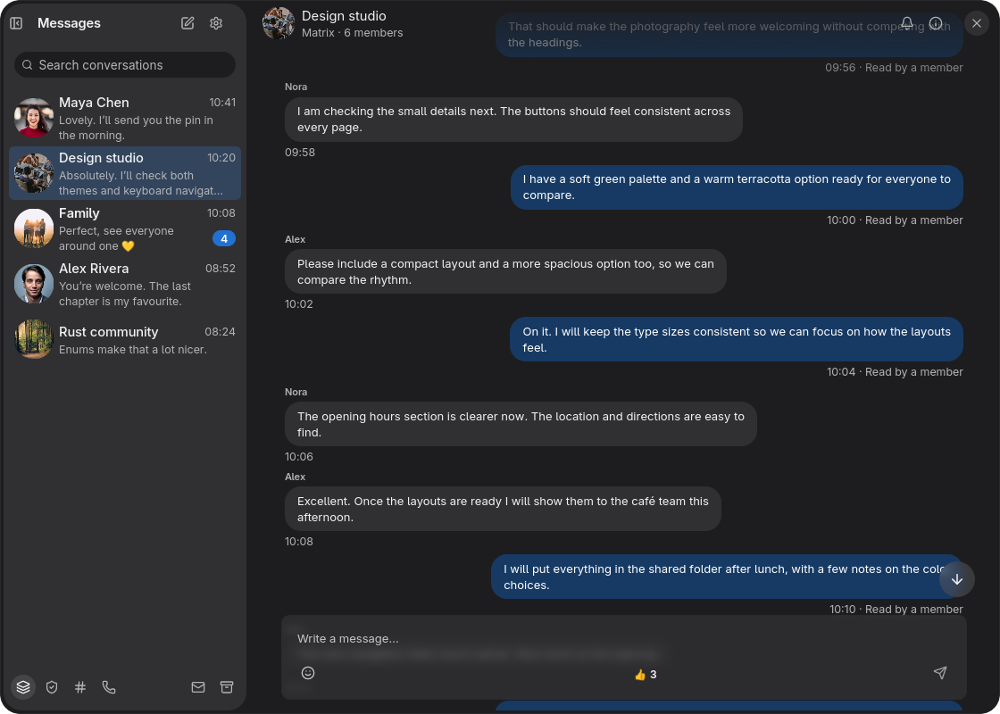
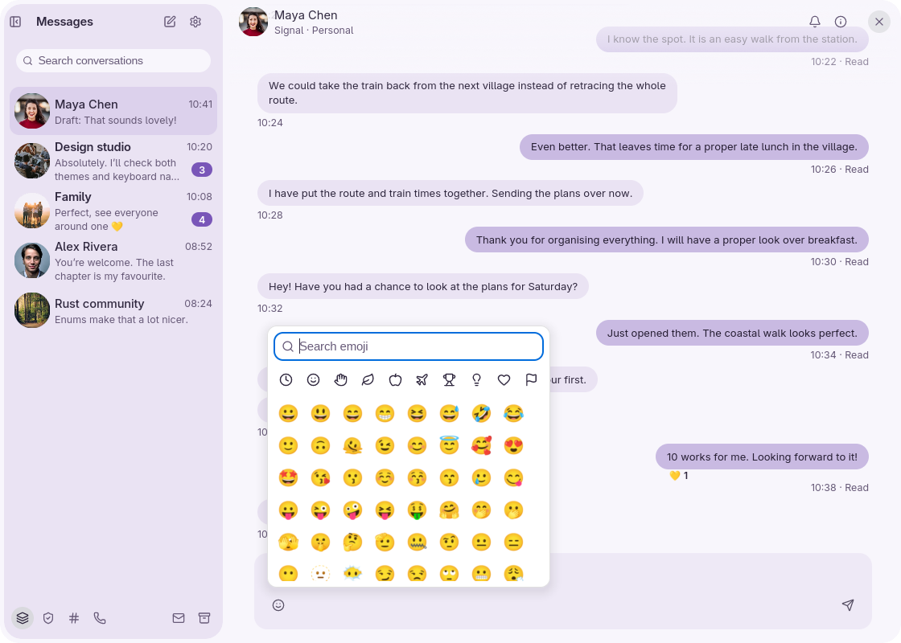
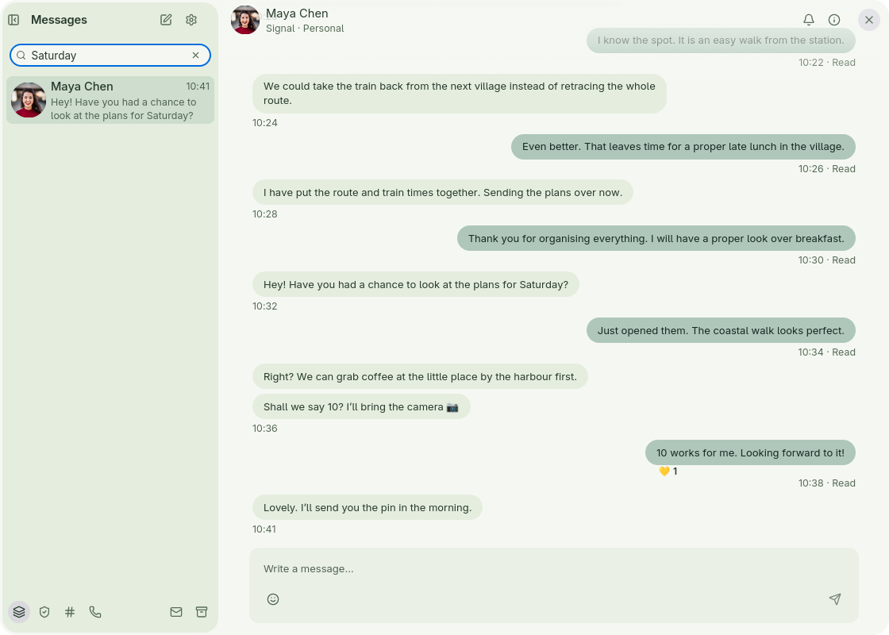
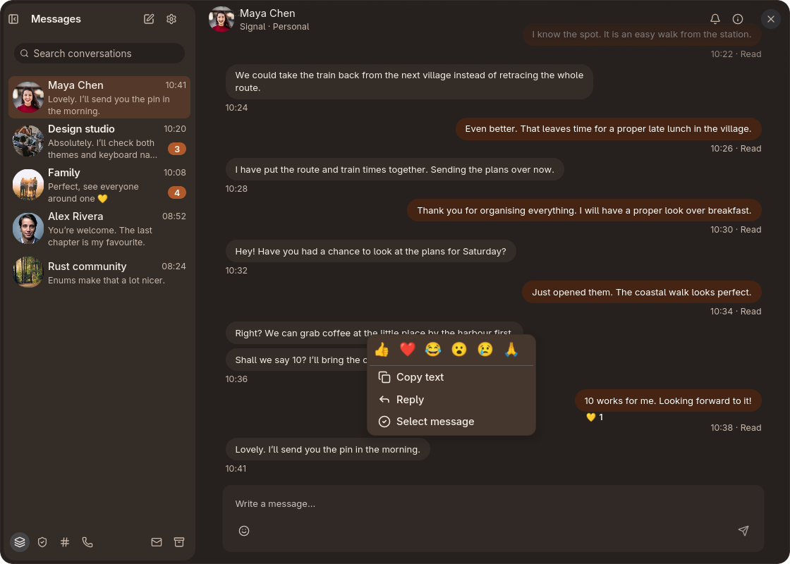
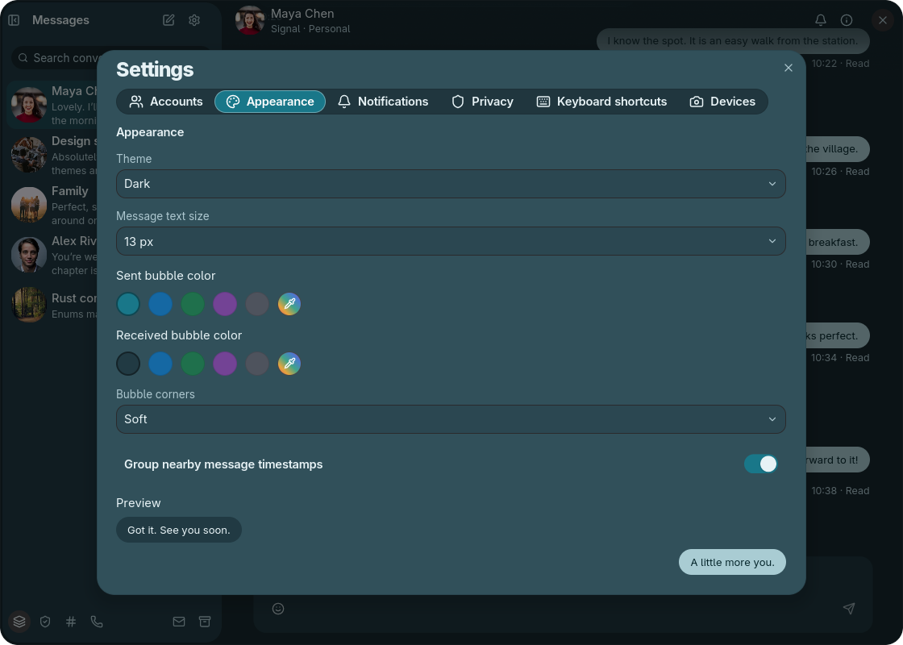
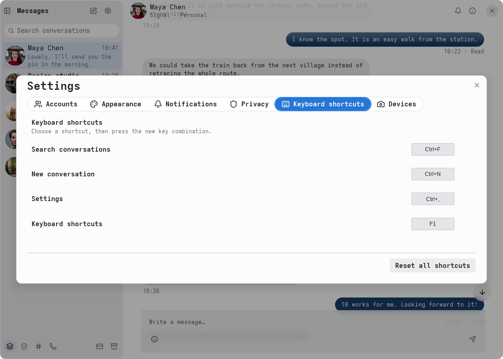
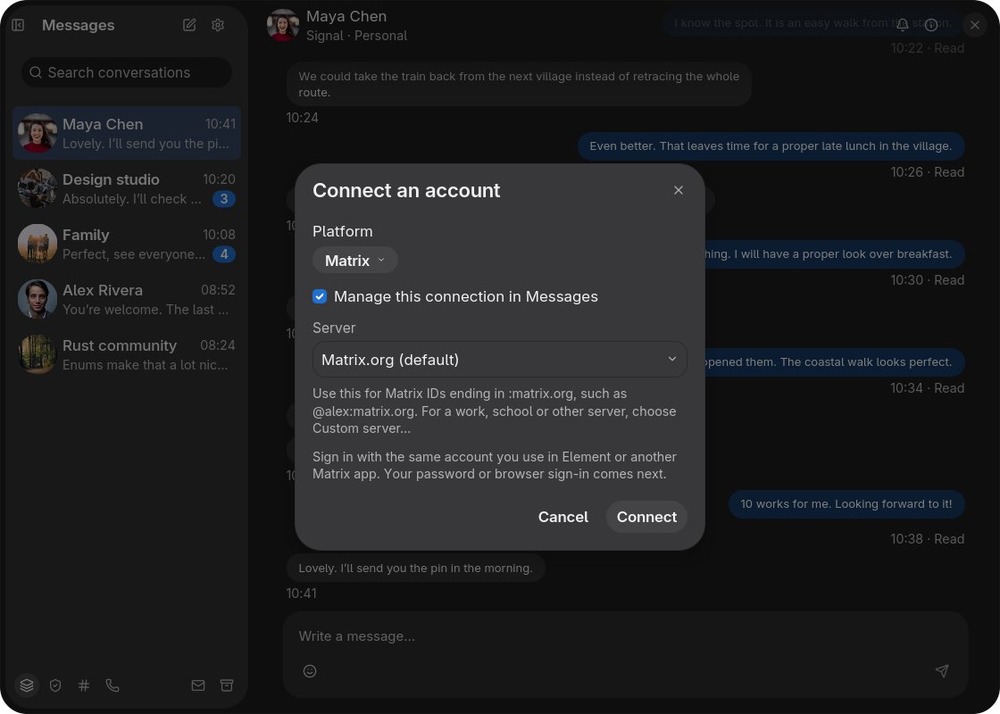

# Messages

A native messaging application for Signal, Matrix and WhatsApp, built with
[enzUI](https://github.com/enz1m/enzui). Keep conversations, drafts, credentials
and attachments separate for each account.

<table>
  <tr>
    <td align="center"><a href="docs/screenshots/basic-light.png"></a><br><sub>Default · Conversations</sub></td>
    <td align="center"><a href="docs/screenshots/basic-dark.png"></a><br><sub>Dark · Scrolled conversation</sub></td>
    <td align="center"><a href="docs/screenshots/lavender.png"></a><br><sub>Lavender · Emoji</sub></td>
    <td align="center"><a href="docs/screenshots/sage.png"></a><br><sub>Sage · Search</sub></td>
  </tr>
  <tr>
    <td align="center"><a href="docs/screenshots/ember.png"></a><br><sub>Ember · Conversation actions</sub></td>
    <td align="center"><a href="docs/screenshots/lagoon.png"></a><br><sub>Lagoon · Appearance</sub></td>
    <td align="center"><a href="docs/screenshots/precision.png"></a><br><sub>Precision · Keyboard shortcuts</sub></td>
    <td align="center"><a href="docs/screenshots/comfort.png"></a><br><sub>Comfort · Account setup</sub></td>
  </tr>
</table>

Click a screenshot to enlarge. All conversations and account names shown are
fictional sample data, illustrated with stock profile photos from
[Unsplash](https://unsplash.com/license). These screenshots do not demonstrate live
provider sessions.

## Features

- Account-scoped conversations, replies, reactions, edits, drafts and search.
- Native file attachments and drag and drop, recent emoji and shared media views.
- Durable outgoing messages, explicit recovery for uncertain sends and resume after restart.
- Light/dark themes, system/theme fonts, configurable appearance and keyboard shortcuts.
- Desktop notifications and partial German/Arabic translations.

| Service | Integration | Current limits |
| --- | --- | --- |
| Signal | Linked mobile account, direct/existing group chats, text/files and receipts | No calls or group administration |
| Matrix / Element | Native encrypted store, encrypted attachments, password/browser sign-in and key recovery | No interactive device verification or calls; old history needs its keys |
| WhatsApp | Linked account, native session/history, text/files and direct call transport | Complete history and live call/relay interoperability remain unqualified |

Discord and Telegram are unavailable. Unsupported saved accounts remain read-only.
See [protocol support and limits](docs/protocols.md) for provider-specific behavior.

## Build and run

Use Rust **1.99.1** and the native development libraries required by enzUI:
Wayland/XKB, Vulkan/EGL, GLib/GIO, GTK4, GStreamer and libheif. The desktop
workspace supports Rust **1.95**; the separate native-helper workspace requires
**1.96**. A C/C++ compiler and pkg-config are needed.

```sh
git clone https://github.com/enz1m/messages.git
cd messages
cargo fetch --locked
cargo build --locked
cargo run --locked --bin enz-messages
```

Dependencies pin public [enzUI Alpha 0.1](https://github.com/enz1m/enzui/releases/tag/v0.1.0-alpha.1)
and its public foundation forks. No sibling checkout or submodule is required.
Wayland is the default; enable `--features x11` for X11. Use
`cargo build --release --locked` for an optimized desktop binary.

To connect real accounts, build the native hosts beside the desktop executable:

```sh
cargo build --locked --manifest-path crates/messages-bridge/Cargo.toml \
  --target-dir target --features matrix --bin messages-matrix
cargo build --locked --manifest-path crates/messages-bridge/Cargo.toml \
  --target-dir target --features whatsapp --bin messages-whatsapp
./tools/install-signal-cli.sh
```

Use the same target directory for all three builds. `MESSAGES_HELPER_DIR` can
select another helper directory. For optimized helpers, add `--release` to both
helper build commands and run `./tools/install-signal-cli.sh --release`. Helpers
are never resolved through the host PATH.
The Signal installer verifies a pinned Linux x86_64 native runtime and its source;
Signal CLI is GPL-3.0-or-later. Preserve its license and source obligations when
distributing it. See the [native-helper guide](crates/messages-bridge/README.md).
FFmpeg, PulseAudio/V4L2 support and `pactl` are needed for device checks and local
WhatsApp calling. Capture begins only when explicitly requested.

## Accounts and local data

The first launch provides a separate fictional sample workspace. Add accounts in
Settings → Accounts; Signal and WhatsApp link a mobile account with a QR code.
Matrix uses the account's homeserver and advertised sign-in methods. Sample
conversations never send to a provider.

State lives in `$XDG_DATA_HOME/enz-messages` (normally
`~/.local/share/enz-messages`). `MESSAGES_STATE_DIR` selects isolated state for
development and screenshots. Real and sample snapshots remain separate.
Credentials use Secret Service or private SDK storage; snapshots contain no
passwords or tokens. An unavailable keyring permits session-only connections
where possible. Account removal retires pending work and erases that account's
private helper state and staged attachments after the removal commits. Files
saved elsewhere are retained.

System appearance is the default. App-specific appearance settings preserve
existing enzUI tokens. Theme changes apply live; the interface uses theme/system
fonts. The composer supports up to ten attachments totaling 100 MB, subject to
room capabilities. Interrupted sends with an uncertain outcome require explicit
handling rather than automatic retry.

## Development

```sh
cargo fmt --all -- --check
ICED_TEST_BACKEND=software cargo test --locked --workspace --all-targets
cargo clippy --locked --workspace --all-targets --all-features -- -D warnings
```

The account-free HTTP test server runs with `cargo run -p messages-test-server`.
Tests exercise actual loopback requests and storage effects, without connecting
real accounts. They do not qualify provider interoperability or hardware calls.
See [contributing](CONTRIBUTING.md) for workspace structure and helper checks.

Licensed under [MIT](LICENSE); third-party helpers retain their own licenses.
